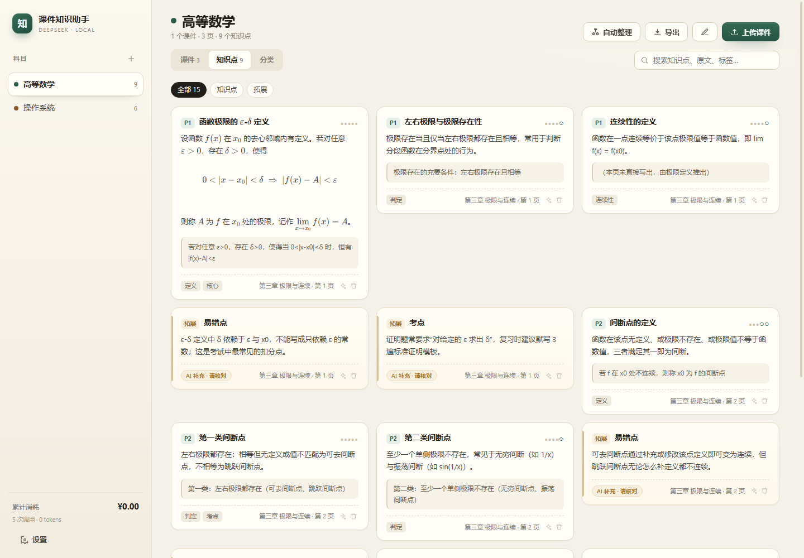
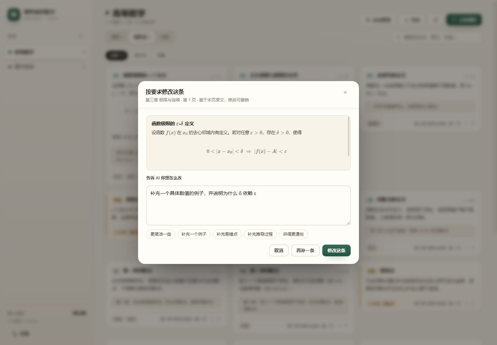
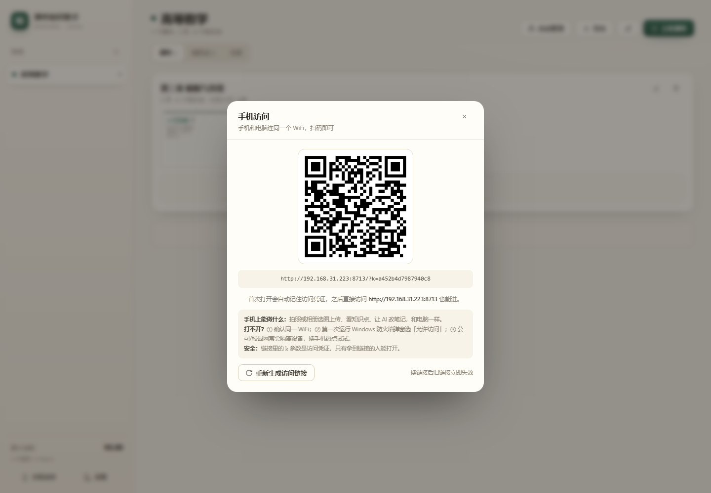

# Make Your Notes

把课件和随手记，变成可以反复复习的结构化知识库。

按科目上传课件截图 → DeepSeek 逐页提取知识点、补充拓展 → 也可以自己手写（支持 LaTeX）→ 按你的标准整理成目录 → 导出 Markdown / 备份。
所有图片和笔记都保存在本机，只有图片和文字会发送给 DeepSeek。


---

## 快速开始

1. 安装 [Node.js](https://nodejs.org/) 18 或更高版本（只需装一次）。
2. 双击 **`启动.bat`**（想让它一直挂在后台，用 **`后台启动.vbs`**，见下文）。
3. 浏览器会自动打开 `http://127.0.0.1:8713`（如果端口被占用会自动顺延）。
4. 点左下角 **设置**，粘贴你的 DeepSeek API Key（在 [platform.deepseek.com](https://platform.deepseek.com/api_keys) 创建）。
5. 点 **+** 新建一个科目，把课件图片拖进窗口，剩下的自动完成。

> 没有 Key 也可以先体验：设置里打开 **演示模式**，不会调用 API，返回示例数据。

关闭那个黑色命令行窗口，程序就退出了。

**只想在手机上用、不想开电脑？** 直接安装 `Make Your Notes.apk`，见下面的「手机本地版」。

---

## 手机上用

1. 电脑上双击 **`后台启动.vbs`**（静默启动，没有窗口）。
2. 点左下角 **手机访问**，用手机相机扫弹出的二维码。
3. 手机和电脑连同一个 WiFi 即可，第一次打开会记住访问凭证，之后可以直接从桌面书签进。

手机端和电脑是同一套界面，只是重新排过版：顶部切换科目、右上角上传（可直接调相机或相册）、底部标签切换课件 / 知识点 / 分类、右下角 `⋯` 里是整理、导出、设置等。

**「后台识别」**：上传后的识别任务由电脑上的服务执行，手机锁屏、切 App、关掉浏览器都不影响。回到页面时结果已经在了，右下角也会显示 `后台识别中 3 / 12` 的进度。

> 打不开时：① 确认同一 WiFi；② 第一次运行时 Windows 防火墙弹窗点「允许访问」；③ 公司/校园网常会隔离设备，换手机热点试试。

---

## 手机本地版（APK，不需要电脑）

`Make Your Notes.apk` 是完整装在手机里的版本：Node 运行时、服务端、前端全部打包进 APK，不连电脑、不依赖 WiFi。数据存在手机应用私有目录里，DeepSeek 请求直接从手机发出。

**安装**：把 APK 传到手机（微信文件传输助手 / 数据线都行），点开安装。系统提示「未知来源」是正常的——这是自签名包，没走应用商店。

- 只支持 **arm64** 手机（2017 年以后的机型基本都满足）
- 首次启动会解压资源并拉起本地服务，约 2~5 秒，看到一个启动日志页，然后自动进入界面
- 卸载才会删数据；用同一个签名覆盖安装会保留
- 手机版没有「手机访问」入口（它自己就是本机）
- 万一启动失败，启动页会直接显示 Node 的报错日志，截图就能定位问题

**重新构建**（改了代码以后）：

```powershell
cd android
powershell -ExecutionPolicy Bypass -File build.ps1
```

脚本会把 `server/` `public/` 打成 `assets/app.zip`，用 NDK 编译 JNI 胶水层，再走 aapt2 → javac → d8 → zipalign → apksigner，最后生成根目录的 `Make Your Notes.apk`。依赖本机已有的 `D:\dshwork\tools`（JDK 21 + Android SDK 35 + NDK）和 `D:\dshwork\nodejs-mobile`（Node 18.20.4 arm64 运行时）。

> 构建时会先把源码复制到临时 ASCII 目录再编译，因为 aapt2 处理不了中文路径。

---

## 后台运行

| 文件 | 作用 |
|---|---|
| `后台启动.vbs` | 静默启动，不开窗口，关掉浏览器也继续跑 |
| `停止.bat` | 按 `data/server.pid` 精确结束进程 |
| `安装开机自启.bat` | 注册登录自启（任务计划，无需管理员；失败时右键「以管理员身份运行」） |
| `卸载开机自启.bat` | 取消登录自启 |
| `启动.bat` | 前台启动，带控制台窗口，方便看日志，关窗口即退出 |

重复双击 `后台启动.vbs` 不会起第二个实例，服务会检测到已在运行后直接退出。

---

## 功能

| 功能 | 说明 |
|---|---|
| 科目管理 | 每个科目独立的课件、知识点和目录 |
| 批量上传 | 拖拽、选择文件、Ctrl+V 粘贴，一次几十张；自动压缩到长边 1800px |
| 手机访问 | 同一 WiFi 扫码即用，手机可直接拍照上传；链接带访问凭证，关掉局域网访问后仅本机可用 |
| 手机本地版 | Android APK 内嵌 Node 运行时，整套服务跑在手机里，不需要电脑 |
| 后台识别 | 识别在服务端排队执行，锁屏、关浏览器都会继续，回来直接看结果 |
| 视觉识别 | 调用 `deepseek-flash` 直接读图，逐页提取知识点、公式、存疑内容 |
| 原文对照 | 每个知识点都带 `quote` 原文片段，方便核对模型有没有编 |
| 拓展分离 | 模型补充的背景/易错点/考点单独成块，标「AI 补充 · 请核对」，不与原文混淆 |
| 按需修改 | 对任意条目说「补充一个例子」「压缩到两行」「讲通俗点」，AI 改写；可一键撤销，也能让 AI 直接往本页补条目 |
| 手动笔记 | 自己写知识点，支持 `$...$` / `$$...$$` LaTeX 并实时预览；可挂在某一页，也可只属于科目 |
| 分类标准 | 每个科目可写自己的分类要求（如「按定义/定理/例题分」），不写就用默认标准 |
| 思维导图 | 整个科目或勾选的知识点生成导图，可缩放、适应窗口、导出 PNG |
| 用量明细 | 累计花费、调用次数、tokens；按用途（识别/整理/改稿）和按科目分项，价格按官网口径估算 |
| 公式渲染 | 知识点里的 LaTeX（`$...$`、`$$...$$`）由本地 KaTeX 渲染，不会出现 `\frac`、`\varepsilon` 这类乱码 |
| 自动整理 | 可开关。开启后识别完成即归类；也可随时手动「重新整理」 |
| 搜索 | 按知识点名称、解释、原文、标签搜索 |
| 导出 / 备份 | 按科目导出 Markdown、一次备份全部科目（含图片、可恢复）、或纯文字 JSON |
| 成本统计 | 记录调用次数、token 与估算费用 |
| 断点续跑 | 失败页面可单独重试，不会重复扣成功的页 |

---

## 界面

**知识点卡片**：原文与拓展用不同底色区分，星级表示重要程度。



**页面详情**：左边原图，右边结构化结果，可查看逐字转录。


**自动分类**：模型把知识点整理成 2~3 层目录，点条目可跳回原页。


**按需修改**：选中一条笔记，用一句话告诉 AI 怎么改，改完还能撤销。



**手机端**：同一 WiFi 下扫码即用，可拍照上传。




---

## 让 AI 改笔记

知识点卡片右下角有一个 ✦ 按钮，点开有两种用法：

- **修改这条**：写一句要求，比如「把解释压到两行」「补一个数值例子」「把推导补上」。AI 会带着本页原文转录一起看，改写不会脱离这一页乱编。改完保留旧版本，弹窗里可以「撤销上次修改」。
- **再补一条**：保留原条目，让 AI 追加一条（适合「补一个易错点」）。也可以在页面详情里点「AI 补充本页」，一次补 1~3 条。

要求可以写得很随意，例如「δ 和 ε 的关系讲清楚一点」「换成一个文科生也能懂的例子」。

---

## 手动写笔记

「知识点」页右上角的「＋ 手动笔记」，页面详情里的「手动笔记」，或科目菜单 / 手机 `⋯` 菜单里都能进。

- 类型（知识点 / 拓展）、重要度、标签都可以选
- 顶部有 **「让 AI 起草」**：写一句要求（如「用两句话解释洛必达法则的适用条件，并给一个例子」），AI 会填好标题、内容、标签和重要度，你再改再保存
- 内容支持 LaTeX，输入时下方实时预览，不用猜渲染结果
- 输入框下面有**符号键盘**（常用 / 希腊 / 运算 / 集合），点一下就把符号插到光标位置，输入框里看到的就是 `ε ≥ ∑ ∫ ∈` 本身，不是 `\varepsilon` 这种代码
- 归属可以选「不关联页面」（只属于这个科目），从某一页进来时则直接挂到那一页
- 手写的条目标着「手动笔记」，之后可以点 ✎ 再改

手写的知识点和 AI 提取的一样会参与「自动整理」，只是不会立刻归类——点一次「重新整理」，或者等下次识别完自动整理。

## 分类标准（每个科目单独设置）

科目菜单 →「分类标准」，写一段你希望的分类方式，例如：

> 按教材章节分一级；每章下按「定义 / 定理 / 例题 / 易错点」分二级；公式密集的单独放「公式速查」

保存后点「重新整理」生效。留空就用默认标准（按知识脉络整理成 2~3 层目录）。每个科目的标准互不影响。

## 思维导图

「分类」页右上角有 **列表 / 导图** 两个显示模式，切到「导图」就是内嵌在页面里的树状图，**点任意知识点节点直接跳到那一页**（手动笔记则打开编辑）。这个选择会记住，下次进来还是上次的模式。

另外两个入口：

- **整个科目全屏看**：「分类」页的「全屏导图」，或科目菜单 / 手机 `⋯` 菜单
- **选中若干条**：知识点页点「选择」→ 勾选卡片 → 「生成导图」

已经整理过时按「科目 → 目录 → 知识点」画；没整理过就退回按「科目 → 课件 → 页码 → 知识点」画。全屏图可以缩小/放大、点「适应」一屏看全，也能「导出 PNG」——手机上会落到下载目录，方便直接发微信。

## 用量与花费

左下角「累计消耗」点开：

- **总计**：花了多少钱、调用了多少次、消耗多少 tokens
- **按用途**：逐页识别 / 自动整理 / AI 改稿 分别多少
- **按科目**：每个科目分别多少

口径按 DeepSeek 官网 `deepseek-flash` 价格（美元 / 百万 tokens）：输入缓存未命中 $0.30、缓存命中 $0.006、输出 $1.20，按 1 美元 ≈ 7.2 元折算。**空闲时段价格减半**，真实账单通常比这里低，以官网为准。

---

## 数据与隐私

- 所有数据在 **`data/`** 目录：`db.json`（笔记）+ `images/`（图片）。
- API Key 使用 Windows DPAPI 加密后存进 `db.json`，只能被同一台机器的同一用户解开；如果加密不可用会退化为明文，设置页会提示。
- 只有压缩后的课件图片和提示词会发往 `api.deepseek.com`，不会上传到其他地方。
- 局域网访问带随机凭证（链接里的 `k`），不是明文开放；关掉「允许手机访问」后只有本机能连。
- 备份：见下面的「备份与恢复」。

### 识别质量控制

识别不只靠"让模型认真点"，内置了四道约束：

1. **保真规则**：数字保留末尾零与有效数字，单位保留大小写与 µ/m 前缀，区间保留开闭，公式保留编号与多行结构。
2. **易混字符自查**：提示词里给了 `0/O`、`1/l`、`±/∓`、`×/x`、`≤/<`、`∂/d/δ` 等对照表，要求转录后逐项复查。
3. **跨页符号一致**：同一课件里，识别第 N 页时会带上前面页面出现过的符号（ε、δ、∑、∫、≤ 等），避免同一符号前后写法不一致。
4. **严格模式（可选）**：设置里打开后，每页识别完会再拿原图校对一遍，只修正形近字、符号、上下标、单位大小写这类字符差异；每页多一次调用，页面上会显示"二次校对：修正 N 处"。

存疑内容不是一句话，而是结构化记录：`where`（位置）、`seen`（看到什么）、`candidates`（候选）、`why`（为什么不确定）。

## 导出学习笔记与思维导图

导出菜单（右上角上传按钮 → 导出）里新增三项：

| 菜单 | 内容 |
|---|---|
| 学习笔记（含配图） | Markdown：按目录分组，含正文、公式、标签、来源页，以及**内联 SVG 配图**；不含上传的课件原图 |
| 学习笔记（图文文档） | 单文件 HTML：配图按 **3 倍分辨率** 转成 PNG 嵌入，带**可点击目录**，KaTeX（CSS/JS/字体全部内联）离线渲染公式，可一键「打印 / 存为 PDF」（PDF 里目录跳转保留） |
| 思维导图（SVG） | 当前科目分类导图，矢量图，可放大不糊 |

接口：`GET /api/export-notes?subjectId=…&format=md|html`、`POST /api/export-map`。

## 元件库（电路原理图）

AI 生成电路图时可以用内置元件符号，通过 <use> 引用，不用自己画：

```html
<use href="#sym-resistor" transform="translate(160,120)"/>
```

器件坐标以中心为原点，两端器件引脚在 (-20,0) 与 (20,0)。可用符号（40 个）：电阻、电容、电解电容、电感、二极管、稳压管、LED、光电二极管、电池、电压源、电流源、开关、单刀双掷开关、按钮、灯泡、保险丝、热敏电阻、压敏电阻、电位器、晶振、变压器、电机、蜂鸣器、喇叭、天线、排针、整流桥、光耦、NPN/PNP、MOS、运放、与门/或门/非门、接地、VCC、VDD、电流表、电压表。

实现位于 `public/symbols.js`（浏览器与 Node 共用），渲染和导出时都会自动注入 `<defs>`。

**引脚自动吸附**：保存和渲染 AI 生成的图时，导线端点（`<line>` 的端点、`<path>` 的 `M/L` 坐标）会自动吸附到 12px 内最近的器件引脚，AI 画得稍微偏一点也能接上。

## 画图板

知识点页工具栏「✎ 画图」打开全屏画板，画完可以直接存成一条笔记（标签「手绘」，在导出文档里也会带上）。

| 能力 | 说明 |
|---|---|
| 画板设置 | 画板右上角 ⚙：缩放/移动后自动重连导线、引脚自动吸附、显示网格、拖动时对齐网格、**连线绕开元件**（默认都开，会随设置保存） |
| 缩放 / 平移 | **双指同时判断**：两指中点移动就平移、两指距离变化就缩放（可同时进行）；也支持滚轮、＋/− 按钮；「复位」回到 1:1 |
| 画笔 | 自由绘制；开「网格模式」后每段自动变直线、并对齐 10px 网格 |
| 文字 | 点画布输入文字 |
| 图形 | 矩形 / 圆形 / 直线（直线是普通图形，不是导线），左下角可调颜色、粗细、透明度 |
| 画笔 / 图形样式 | 系统调色盘选色（显示十六进制），粗细 1–12 滑杆、透明度 10%–100% 滑杆；画笔与图形**各自独立**保存，导线始终是固定黑色 2px |
| 元件 | 25 个电子元件，点选后放到画布，可拖动、旋转（⟳）、复制（⧉） |
| 连线 | 点起点 → 点拐点 → 点「完成」或按 Enter 结束，**双指轻点取消**；预览是半透明实线、形状就是落笔后的走线；斜线自动折成直角；靠近引脚线任意位置都能吸附（含芯片引脚）；用 A* 网格布线自动绕开所有元件（可在 ⚙ 关闭），起止元件自身不绕行，导线画在元件下层不遮挡器件 |
| 芯片 | 选「芯片」后在画布上**拖出一个矩形**，弹出编辑器（大预览）：在边框上点一下加一个引脚，**按住引脚可拖动**改位置（自动贴边），每个引脚可改编号和名称，芯片名显示在矩形中央；有运放/定时器/稳压器预设；完成后是一个整体 |
| 选择 | 点选 / 框选，拖动移动，Delete 删除；撤销 ↶ 重做 ↷ |
| 组合 | 选中多个图形后点「组合」，之后点任意一个就整组选中、整体移动，相对位置不变；「放大 / 缩小」以组合中心为基准整体缩放，「⟳」整体顺时针旋转 90°（元件、芯片、导线、文字一起转）；「拆开」还原 |

保存后的图在笔记详情里显示，也会出现在学习笔记文档和 Markdown 导出中。

**在笔记里插入配图**：新建/编辑笔记时，「配图」一栏有「✎ 画配图」，画完点「插入配图」直接落到这条笔记里（自动打上「手绘」标签，说明文字显示「手绘配图」）；已有的配图可以「去掉配图」重画。

**配图可以再编辑**：画板数据（图形对象、电子模式开关）随笔记一起保存在 `draw` 字段里；笔记详情里的「✎ 编辑配图」会原样载入上次的图形继续改，不用从头画。备份、恢复、导出都会带上这份数据。

## 用量与备份

- **折线图**：用量面板顶部可切换「按天（近 14 天）/ 按周（近 12 周）/ 按月（近 12 月）」，显示花费曲线与区间合计
- **每日明细**：每次调用都会记到当天的桶里（tokens、花费、次数），存在 `data/db.json` 的 `usageDaily`
- **完整备份包含**：科目、课件、图片、知识点、目录、设置（不含 API Key）、用量（总体 / 分用途 / 分科目 / 每日）
- **恢复行为**：设置会被套用；用量按天取最大值合并，同一份备份恢复多次不会重复累计；旧备份（v2 单科目 / v3 无设置）仍兼容

## 视图与排序

- **知识点折叠**：卡片正文超过 4 行自动折叠，点「展开全文」看完整内容；详情弹窗里内容过长可滚动
- **排序**：知识点页的下拉可选「按页面 / 按重要度 / 按创建时间 / 按最近修改」
- **课件折叠**：一份课件超过 12 页时先显示 12 页，点「展开剩余 N 页」看全部
- **本节总结**：每份课件标题栏有「本节总结」按钮，把这一节识别过的页面交给 AI，生成一条「本节总结 · 课件名」的笔记，带 `本节总结` 标签，可在知识点页搜到
- **界面大小**会存到服务端（`data/db.json`），重开应用、换端口都能记住

## 知识点的结构

每条知识点有这些字段：

| 字段 | 说明 |
|---|---|
| 标题 | 10~20 字 |
| 内容 | 讲解，可含行内公式 $...$ |
| **公式** | 可与正文分开的核心公式（LaTeX，不写 $），显示在正文下方，导出为 `$...$` 块 |
| 标签 / 重要度 | 用于筛选与复习 |
| 配图 | 按需生成的 SVG |
| 原文引用 | 只进导出的「附注」，正文不显示 |

**改稿合并**：AI 的「补充」模式如果生成的知识点与本页已有条目同名，会**合并进那一条**（内容追加、标签取并集），而不是新增一条重复内容。

**重新识别**：手动笔记和被改过的条目会保留，不会被重新识别冲掉。

## 配图（SVG）

在「让 AI 起草」或「AI 修改这条」里，只要你的要求里提到配图（示意图、框图、原理图、流程图、结构图），模型会额外输出一段 **SVG**，直接渲染在笔记里。

- 例：`生成 TPS5430 的 12V 转 5V 模块原理图` → 得到一张带 12V 输入、TPS5430、电感、5V 输出的框图
- 图会跟着知识点一起保存，单条详情里能看到，导出 Markdown 时以内嵌 SVG 图片一并带走
- 生成后会标注「AI 生成的示意图，细节请对照正文核对」——**框图、流程、结构可信；精确的接线和元件参数仍需核对**
- 保存前可以点「去掉配图」删掉

安全上做了两层清洗（服务端 + 前端）：去掉 `<script>`、`<foreignObject>`、`on*` 事件属性和 javascript 链接，模型生成的 SVG 无法执行脚本。

## 备份与恢复

文字和图片要一起搬，才叫备份。

**完整备份**：「导出」→「完整备份（全部科目）」，一次打包**所有科目**，得到一个 zip：

```
manifest.json      # 全部科目、课件、每一页（含转录/公式）、所有知识点、目录树、当前模型设置
images/            # 每页的原图和缩略图（所有科目）
```

图片和知识点的对应关系靠 `slideId`：manifest 里每个知识点带 `slideId`，每条 slide 带 `image` 文件名，恢复时按这个关系重新生成 id 并写回图片，所以恢复后每条笔记都还对着自己那页图。

**恢复**：设置 →「从备份恢复」，选那个 zip。

- 逐个科目处理：有同名科目 → **合并进去**，没有 → 新建一个（不会出现「（恢复）」这种副本）
- 合并时按图片内容哈希去重：同一页已经在库里就跳过它和它的知识点，所以重复恢复同一份备份不会堆出重复内容
- 课件按标题复用，分类按「父级 + 名称」复用，手动笔记按「标题 + 内容」去重

手机上同样可用：导出的 zip 落在下载目录，恢复时从文件里选。

科目名不允许重复：新建或重命名时，若已有同名科目（忽略首尾空格）会被拒绝。

旧的「导出 JSON」只含文字、不能导入，适合自己分析或迁移到别的程序。

---

## 费用

`deepseek-flash` 每页图片约消耗 1000 出头输入 token，输出几百 token：

| 场景 | 费用（高峰价估算） |
|---|---|
| 一页 | 约 ¥0.01 |
| 一门课 300 页 | 约 ¥3 |
| 一学期 8 门课 | 约 ¥26 |

北京时间 09:00–12:00、14:00–18:00（工作日）为高峰，其余时段半价。
实际消耗以 DeepSeek 账单为准，界面里的数字是按公开单价估算的。

## 用智谱免费模型（可选）

设置 → **供应商** → 「智谱 GLM（可免费）」，会自动填好接口地址和模型：

| 模型 | 读图 | 上下文 | 费用 |
|---|---|---|---|
| `glm-4.6v-flash` | ✅ | 128K | 免费 |
| `glm-4v-flash` | ✅ | 短 | 免费（旧版）|
| `glm-4.7-flash` | ❌ 纯文本 | 200K | 免费 |
| `glm-5.3-flash` | ✅ | 长 | 按智谱计费 |

识图优先用 `glm-4.6v-flash`——免费、128K 上下文、支持思考模式，比旧的 `glm-4v-flash` 强不少。纯文字任务（整理、改稿、起草）可以用 `glm-4.7-flash`。

设置里「识别模型」和「文字模型」是分开的，推荐配成：识别 `glm-4.6v-flash`、文字 `glm-4.7-flash`，全程 ¥0。

Key 在 [bigmodel.cn](https://bigmodel.cn) → API Keys 创建。切到智谱后，flash 系列的费用按 **¥0** 计。

两家都是 OpenAI 兼容协议，所以切过去只是换了 baseURL 和模型名。差异点已经处理：

- 智谱认 `thinking.type`，但不认 DeepSeek 的 `reasoning_effort`，选智谱时不会带这个字段
- 智谱部分模型不支持 `response_format`，被拒时会自动去掉该参数、改从文本里解析 JSON
- 有的智谱模型只收裸 base64、不收 `data:` 前缀，遇到图片格式报错会自动去掉前缀重试
- 有的模型对 `max_tokens` 范围要求更严，被拒时会自动降低（4000→2000→1024→512→默认）
- 免费模型有速率限制：遇到 429 会自动退避重试（最多 3 次，遵守 `Retry-After`），批量识别时还会冷却 20 秒后改单线程继续

---

## 设置项

- **供应商**：DeepSeek / 智谱 GLM，切换时自动填好接口地址和模型列表。
- **API Key**：必填（演示模式除外）。留空保存不会清除已存的 Key。
- **识别模型**：需要能读图，只列出当前供应商支持视觉的模型。
- **文字模型**：整理目录、AI 改稿、AI 起草用，只列出纯文本可用的模型。两个模型都来自同一个供应商（一家一个 Key），切供应商会同时换掉这两项。
- **并发数**：同时识别几页，建议 2~3。
- **推理等级**：`关闭 / 低 / 高 / 最大`，对应 DeepSeek 的 `thinking` + `reasoning_effort`。关闭 = 不产生思维链（最快最省）；其余三档会开启思考并指定强度，等级越高推理 token 越多、越慢越贵，但抽取和归类更准。默认关闭。
- **界面大小**：小 / 标准 / 大 / 特大（0.9～1.2 倍），整体缩放界面。一行放不下的按钮会自动换到下一行，不会横向溢出。
- **上传后自动识别**：关闭后需要手动点「识别」。
- **自动整理目录**：识别完成后自动归类，默认关闭。
- **演示模式**：不调用 API。

---

## 文件结构

```
课件知识点助手/          # 文件夹名沿用旧名，产品名是 Make Your Notes
├─ Make Your Notes.apk        # 手机本地版（装到手机上，不需要电脑）
├─ 启动.bat              # 前台运行（有窗口，看日志用）
├─ 后台启动.vbs          # 静默后台运行
├─ 停止.bat              # 停止后台进程
├─ 安装开机自启.bat / 卸载开机自启.bat
├─ server/               # 本地服务（零第三方依赖）
│  ├─ server.js          # HTTP 路由、局域网访问、后台识别队列
│  ├─ deepseek.js        # 提示词、API 调用、演示数据
│  ├─ store.js           # db.json 读写
│  └─ secret.js          # DPAPI 加密
├─ public/               # 前端（原生 JS，无构建步骤）
│  ├─ index.html
│  ├─ styles.css
│  ├─ app.js
│  ├─ vendor/katex/      # 本地公式渲染（离线可用）
│  └─ vendor/qrcode/     # 手机访问二维码
├─ android/              # 打包 APK 的工程（可重新构建）
│  ├─ AndroidManifest.xml
│  ├─ src/…/MainActivity.java   # 解压 payload、拉起 Node、WebView、选图/拍照、下载
│  ├─ jni/node_bridge.cpp       # 调 node::Start 的 JNI 胶水
│  ├─ assets/cacert.pem         # 补充 CA（Android 上 Node 信任库兜底）
│  ├─ res/                      # 图标与名称
│  └─ build.ps1                 # 一条命令出 APK
├─ data/                 # 运行时生成：笔记 + 图片 + server.pid
├─ 截图/                  # 界面截图
└─ 可行性评估.md          # 立项时的技术与成本评估
```

---

## 常见问题

**打开是空白页 / 连不上**
命令行窗口要一直开着。若 8713 被占用，实际端口看窗口里打印的地址。

**识别结果不准**
多数是图片质量问题。把原图放大看看文字是否清晰；投影反光、倾斜、摩尔纹都会影响识别。可以只截取 PPT 内容区域再上传。文字特别密的页面，建议分上下两半截两张图。

**提示「API Key 无效」**
检查是否复制完整、账户是否有余额。可在设置里点「测试连接」。

**整理结果不理想**
直接点「重新整理」，模型每次结果会略有不同。归类只针对知识点，不会改动原文。

**公式显示成了 `\frac{1}{2}` 这样的代码？**
说明这段文字没有用 `$` 包裹。点该条目的 ✦，写一句「公式改用 LaTeX，并用 $ 包起来」即可。识别提示词里已经要求使用 LaTeX，正常情况不会出现。

**想换电脑**
复制整个文件夹（含 `data/`）过去即可。API Key 因 DPAPI 加密无法跨机器解密，需要重新填一次。

**端口被占用**
默认 8713，被占用会自动尝试 8714、8715……看命令行窗口打印的实际地址。后台模式下如果已经有一个实例在跑，再次启动会直接退出，不会占新端口。

**手机连不上**
先确认手机和电脑在同一 WiFi；再检查电脑是否开着（手机只是远程操作，服务必须在电脑上跑）；最后看 Windows 防火墙有没有放行 `node.exe`。公司/校园网常做设备隔离，可用手机热点验证。

**把链接发给了别人会怎样**
链接里的 `k` 参数就是访问凭证，拿到链接的人能在局域网内打开你的笔记并使用你的 API Key。不想共享时：设置里关掉「允许手机访问」，或点「重新生成访问链接」让旧链接失效。

---

## 已知限制 / 后续可做

- 手机本地版只有 Android（arm64），没有 iOS 版——iOS 不允许这种内嵌运行时的做法。
- APK 是自签名包，安装时要允许「未知来源」，也不能上架应用商店。
- 电脑版是「本地服务 + 浏览器」形态，没有打包成 exe。
- 图片密集小字受模型单图 1024 token 上限影响，暂未做自动切块识别。
- 归类会重建整个目录，手动改过的分类会被覆盖（下一版可做增量合并）。
- 不支持 PDF / PPTX 直接导入，需要先转成图片。
- 手机端暂不支持一键分享/打印，导出走浏览器下载。

---

## 更新记录

- **v3.10.23 / APK versionCode 78**：导线端点可吸附——新导线连到已有导线的端点会自动绑定；拖动源端点时，绑定端跟随并重新走线。
- **v3.10.22 / APK versionCode 77**：修复芯片/元件本体压到自身导线时避让失效（导线直穿芯片）的问题——碰撞豁免现在只对导线真正的起止点生效，中间拐点不再绕过检测；绕行候选也改为沿元件边缘生成，大芯片能正常绕过去。
- **v3.10.21 / APK versionCode 76**：网格模式下点终点不再自动成线，终点保持显示、不再橡皮筋跟随，必须点「完成」才结束连线。
- **v3.10.20 / APK versionCode 75**：去掉「双击结束连线」（容易误触，改用右侧「完成」或 Enter）；拖动导线段/折点改为增量跟随，不再按 10px 网格跳动，线随手指走。
- **v3.10.19 / APK versionCode 74**：拖动导线任意一段时，与其两端相连的线段会自动伸长/缩短；手动调整后不再被「自动重连」覆盖；接引脚的一端保持固定，必要时自动补一个折点维持直角。
- **v3.10.18 / APK versionCode 73**：导线改为「分段操作」（参考嘉立创 EDA）：点选其中一段、拖动整段平移、拖端点改折点、删除只删这一段（其余自动拆分）。
- **v3.10.17 / APK versionCode 72**：修复定义芯片时引脚无法拖动的问题——预览坐标改用 SVG 的屏幕变换矩阵换算，缩放和等比留白下都准确。
- **v3.10.16 / APK versionCode 71**：修复「完成」按钮在只点了起点时无法成线（改为按当前指针位置收尾）；选中优先级调整——芯片/元件/文字/图形优先，导线必须点在线上才选中，解决导线绕住芯片后选不到芯片的问题。
- **v3.10.15 / APK versionCode 70**：公式合集里的说明文字不再截断，保留知识点正文全文（保留换行）。
- **v3.10.14 / APK versionCode 69**：新增「公式合集」导出，按分类（含未分类）汇总当前科目所有公式，输出为带 KaTeX 的离线 HTML，方便打印成 PDF。
- **v3.10.13 / APK versionCode 68**：画笔与图形的颜色/粗细/透明度改为各自独立；改用系统调色盘 + 连续滑杆（粗细 1–12、透明度 10%–100%）；导线颜色粗细固定，不再受画笔影响。
- **v3.10.12 / APK versionCode 67**：修复画板「元件 / 图形」面板可以反复打开导致堆叠的问题——同一时间只保留一个浮层，再点同一个工具会关闭它，打开图形面板会自动收起元件面板。
- **v3.10.11 / APK versionCode 66**：修复连线时多画一条「起点到中点」预览线的问题（提交拐点后清理旧预览、预览尾点去重、鼠标未离开落点时不画延续线）；网格模式下点完终点自动成线。
- **v3.10.10 / APK versionCode 65**：「重连」按钮改为取消当前正在画的线、重新连一条（不再是重新规划已有导线）；「完成」仍然是结束当前连线。
- **v3.10.9 / APK versionCode 64**：修复导线仍会穿过元件的问题——碰撞检测改成按「走线方向」判断：从引脚朝外走才放行，朝元件内部走仍判为撞；A* 在起终点周围留出 16px 连接区，避免从引脚出发被自己元件堵死。
- **v3.10.8 / APK versionCode 63**：新增「常用图形」（矩形/圆形/直线）与画笔样式（6 色、5 档粗细、3 档透明度）；导线交叉处显示结点；右侧面板新增「完成」「重连」；普通模式连线恢复为自动绕开元件的直角走线；非端点不再强行吸附引脚。
- **v3.10.7 / APK versionCode 62**：网格模式连线改成「管道式」：点起点和终点自动规划规整直角折线并绕开元件，右侧新增方向优先按钮（自动/上/右/下/左）；普通模式恢复自由直角走线（不吸网格、不做自动避让）；自动重连改用同一套布线并会绕开元件。
- **v3.10.6 / APK versionCode 61**：新增「复制内容」按钮（标题+正文+公式+原文一键进剪贴板）；设置里新增「允许选中文字」开关，可在需要时恢复手动选中复制。
- **v3.10.5 / APK versionCode 60**：全局禁止选中文字与长按菜单（输入框、可编辑区仍可正常选择与编辑）。：修复界面大小切换后按钮不跟随/不保存的问题；修复画板在非 100% 界面大小下「下笔位置与笔画位置错位」的问题（SVG 用 clientWidth 换算页面缩放）。
- **v3.10.4 / APK versionCode 59**：布线改用 A* 网格寻路，绕开所有元件而不是只绕一段；新增「连线绕开元件」开关（关闭后回到简单直角走线）；预览加了缓存，拖动时不卡。
- **v3.10.3 / APK versionCode 58**：设置里新增「修复手绘图」，一键把旧手绘图的内嵌符号换成最新定义、导线重新吸附到新引脚；同步更新 AI 提示词里的元件坐标表（与新符号一致）。
- **v3.10.2 / APK versionCode 57**：重画全部元件符号，保证引脚正好落在图形端点（电阻等不再出现「引脚在图标外」）；「电子模式」改名「网格模式」；关闭网格模式时连线不再吸网格但仍保持直角折线；修正连线穿过元件的问题。
- **v3.10.1 / APK versionCode 56**：芯片引脚判定区加大到屏幕 26px（按屏幕距离找最近引脚，不再依赖小圆点本身），引脚圆点也画得更大，方便按住在边框上拖动。
- **v3.10.0 / APK versionCode 55**：元件库从 25 个扩到 40 个（新增晶振、电位器、压敏电阻、光电二极管、光耦、单刀双掷、按钮、蜂鸣器、喇叭、天线、排针、整流桥、与/或/非门）；导出的图文笔记里配图改为 3 倍分辨率，打印更清晰。
- **v3.9.13 / APK versionCode 54**：画板设置（自动重连、吸附、网格、拖动对齐）保存到服务端，重开画板/重启应用都保留；拖动吸附改成「整组统一偏移」，多折点导线拖动时形状不变。
- **v3.9.12 / APK versionCode 53**：画板设置新增「拖动时对齐网格」开关（电子模式下拖动元件/导线按 10px 跳动）。
- **v3.9.11 / APK versionCode 52**：连线预览改为半透明实线并显示最终走向（与落笔后的线完全一致）；电子模式下元件放置、芯片矩形、芯片引脚位置都对齐 10px 网格。
- **v3.9.10 / APK versionCode 51**：引脚吸附区从「端点」扩展到整条引脚线；双指取消连线改为抬手判定（两指移动超过 12px 视为平移/缩放，不会误取消）。
- **v3.9.9 / APK versionCode 50**：连线时双指轻点可取消；修复芯片引脚吸附不了的问题（元件的障碍框不再把引脚包进去，且起止元件不参与绕障）；吸附容差放宽到 26px。
- **v3.9.8 / APK versionCode 49**：定义芯片时，已放下的引脚可以直接拖动改变位置（自动吸附到矩形最近的一条边，编号和名称保留）。
- **v3.9.7 / APK versionCode 48**：画板新增设置面板（⚙）：缩放/移动后自动重连导线、引脚自动吸附、显示网格三个开关；导线会记住两端接的引脚，元件缩放/移动/旋转后自动重新接线。
- **v3.9.6 / APK versionCode 47**：组合/选区支持整体缩放（放大、缩小按钮，以选区中心为基准，元件与芯片尺寸一起变）和整体旋转 90°（导线折点、元件朝向、芯片宽高与引脚一起转）。
- **v3.9.5 / APK versionCode 46**：画板工具栏拆成「工具一行 + 操作一行（撤销/缩放/组合等）」；引脚吸附容差按屏幕像素换算并加悬停高亮，更好对准；芯片编辑预览放大到 190px；新增组合/拆开（整组选中、整体移动）。
- **v3.9.4 / APK versionCode 45**：芯片改为「拖矩形 + 边框点选引脚」的自定义方式（引脚可改编号/名称、自动吸附边框、芯片名居中、整体可拖动）；连线自动绕开元件，导线渲染在元件下层，不再遮挡器件。
- **v3.9.3 / APK versionCode 44**：画板双指手势改为「平移 + 缩放同时判断」（两指中点移动即拖动画面，距离变化即缩放）；芯片改为独立对话框（名称/左右引脚/预设），不再弹单行输入框。
- **v3.9.2 / APK versionCode 43**：手绘配图可再次编辑（画板数据随笔记保存，详情页「编辑配图」载入原图继续改）；修复符号库 path 解析把「M-6-9」这类连写坐标弄坏的问题（电容、接地等符号显示不全），旧数据渲染时自动换成最新符号定义。
- **v3.9.1 / APK versionCode 42**：笔记编辑器支持直接画配图——「配图」栏新增「✎ 画配图」，画板进入插入模式，画完插进当前笔记（自动打「手绘」标签），保存笔记后生效。
- **v3.9.0 / APK versionCode 41**：新增全屏画图板（缩放/画笔/文字/元件/连线/自定义芯片/框选移动/撤销重做）；电子模式自动直角走线、网格对齐、引脚吸附；图文笔记文档改为**完全离线**（KaTeX 的 CSS、JS、字体全部内联，约 630KB）。
- **v3.8.1 / APK versionCode 40**：学习笔记新增「图文文档」（HTML）：AI 配图转成 PNG 嵌入、带可点击目录、KaTeX 渲染公式、可一键打印成 PDF；元件库加入引脚自动吸附（导线端点 12px 内自动对齐器件引脚）。
- **v3.8.0 / APK versionCode 39**：新增「学习笔记（含配图）」Markdown / HTML 导出（内联 AI 生成的 SVG，不含课件原图）与「思维导图（SVG）」导出；新增电子元器件符号库（25 个符号），提示词引导 AI 用 `<use>` 画电路原理图，导出与页面渲染都自动注入符号定义。
- **v3.7.1 / APK versionCode 38**：全局禁止双指缩放（viewport、WebView 内置缩放都关掉），改用应用内的界面大小；分类导图 / 全屏导图支持双指缩放与拖动（0.3x~4x），双击或「复位缩放」还原。
- **v3.7.0 / APK versionCode 37**：完整备份现在包含全部设置（模型、推理档位、界面缩放、折叠行数、显示开关等）与用量数据（总体、分用途、分科目、每日明细）；恢复时自动套用设置并合并用量（按天取最大值，重复恢复不会翻倍）；用量面板新增按天/周/月折线图；旧版 v2/v3 备份仍可直接恢复。
- **v3.6.4 / APK versionCode 36**：修复提示词里独立公式分隔符被写成 `$...# Make Your Notes

把课件和随手记，变成可以反复复习的结构化知识库。

按科目上传课件截图 → DeepSeek 逐页提取知识点、补充拓展 → 也可以自己手写（支持 LaTeX）→ 按你的标准整理成目录 → 导出 Markdown / 备份。
所有图片和笔记都保存在本机，只有图片和文字会发送给 DeepSeek。


---

## 快速开始

1. 安装 [Node.js](https://nodejs.org/) 18 或更高版本（只需装一次）。
2. 双击 **`启动.bat`**（想让它一直挂在后台，用 **`后台启动.vbs`**，见下文）。
3. 浏览器会自动打开 `http://127.0.0.1:8713`（如果端口被占用会自动顺延）。
4. 点左下角 **设置**，粘贴你的 DeepSeek API Key（在 [platform.deepseek.com](https://platform.deepseek.com/api_keys) 创建）。
5. 点 **+** 新建一个科目，把课件图片拖进窗口，剩下的自动完成。

> 没有 Key 也可以先体验：设置里打开 **演示模式**，不会调用 API，返回示例数据。

关闭那个黑色命令行窗口，程序就退出了。

**只想在手机上用、不想开电脑？** 直接安装 `Make Your Notes.apk`，见下面的「手机本地版」。

---

## 手机上用

1. 电脑上双击 **`后台启动.vbs`**（静默启动，没有窗口）。
2. 点左下角 **手机访问**，用手机相机扫弹出的二维码。
3. 手机和电脑连同一个 WiFi 即可，第一次打开会记住访问凭证，之后可以直接从桌面书签进。

手机端和电脑是同一套界面，只是重新排过版：顶部切换科目、右上角上传（可直接调相机或相册）、底部标签切换课件 / 知识点 / 分类、右下角 `⋯` 里是整理、导出、设置等。

**「后台识别」**：上传后的识别任务由电脑上的服务执行，手机锁屏、切 App、关掉浏览器都不影响。回到页面时结果已经在了，右下角也会显示 `后台识别中 3 / 12` 的进度。

> 打不开时：① 确认同一 WiFi；② 第一次运行时 Windows 防火墙弹窗点「允许访问」；③ 公司/校园网常会隔离设备，换手机热点试试。

---

## 手机本地版（APK，不需要电脑）

`Make Your Notes.apk` 是完整装在手机里的版本：Node 运行时、服务端、前端全部打包进 APK，不连电脑、不依赖 WiFi。数据存在手机应用私有目录里，DeepSeek 请求直接从手机发出。

**安装**：把 APK 传到手机（微信文件传输助手 / 数据线都行），点开安装。系统提示「未知来源」是正常的——这是自签名包，没走应用商店。

- 只支持 **arm64** 手机（2017 年以后的机型基本都满足）
- 首次启动会解压资源并拉起本地服务，约 2~5 秒，看到一个启动日志页，然后自动进入界面
- 卸载才会删数据；用同一个签名覆盖安装会保留
- 手机版没有「手机访问」入口（它自己就是本机）
- 万一启动失败，启动页会直接显示 Node 的报错日志，截图就能定位问题

**重新构建**（改了代码以后）：

```powershell
cd android
powershell -ExecutionPolicy Bypass -File build.ps1
```

脚本会把 `server/` `public/` 打成 `assets/app.zip`，用 NDK 编译 JNI 胶水层，再走 aapt2 → javac → d8 → zipalign → apksigner，最后生成根目录的 `Make Your Notes.apk`。依赖本机已有的 `D:\dshwork\tools`（JDK 21 + Android SDK 35 + NDK）和 `D:\dshwork\nodejs-mobile`（Node 18.20.4 arm64 运行时）。

> 构建时会先把源码复制到临时 ASCII 目录再编译，因为 aapt2 处理不了中文路径。

---

## 后台运行

| 文件 | 作用 |
|---|---|
| `后台启动.vbs` | 静默启动，不开窗口，关掉浏览器也继续跑 |
| `停止.bat` | 按 `data/server.pid` 精确结束进程 |
| `安装开机自启.bat` | 注册登录自启（任务计划，无需管理员；失败时右键「以管理员身份运行」） |
| `卸载开机自启.bat` | 取消登录自启 |
| `启动.bat` | 前台启动，带控制台窗口，方便看日志，关窗口即退出 |

重复双击 `后台启动.vbs` 不会起第二个实例，服务会检测到已在运行后直接退出。

---

## 功能

| 功能 | 说明 |
|---|---|
| 科目管理 | 每个科目独立的课件、知识点和目录 |
| 批量上传 | 拖拽、选择文件、Ctrl+V 粘贴，一次几十张；自动压缩到长边 1800px |
| 手机访问 | 同一 WiFi 扫码即用，手机可直接拍照上传；链接带访问凭证，关掉局域网访问后仅本机可用 |
| 手机本地版 | Android APK 内嵌 Node 运行时，整套服务跑在手机里，不需要电脑 |
| 后台识别 | 识别在服务端排队执行，锁屏、关浏览器都会继续，回来直接看结果 |
| 视觉识别 | 调用 `deepseek-flash` 直接读图，逐页提取知识点、公式、存疑内容 |
| 原文对照 | 每个知识点都带 `quote` 原文片段，方便核对模型有没有编 |
| 拓展分离 | 模型补充的背景/易错点/考点单独成块，标「AI 补充 · 请核对」，不与原文混淆 |
| 按需修改 | 对任意条目说「补充一个例子」「压缩到两行」「讲通俗点」，AI 改写；可一键撤销，也能让 AI 直接往本页补条目 |
| 手动笔记 | 自己写知识点，支持 `$...$` / `$$...$$` LaTeX 并实时预览；可挂在某一页，也可只属于科目 |
| 分类标准 | 每个科目可写自己的分类要求（如「按定义/定理/例题分」），不写就用默认标准 |
| 思维导图 | 整个科目或勾选的知识点生成导图，可缩放、适应窗口、导出 PNG |
| 用量明细 | 累计花费、调用次数、tokens；按用途（识别/整理/改稿）和按科目分项，价格按官网口径估算 |
| 公式渲染 | 知识点里的 LaTeX（`$...$`、`$$...$$`）由本地 KaTeX 渲染，不会出现 `\frac`、`\varepsilon` 这类乱码 |
| 自动整理 | 可开关。开启后识别完成即归类；也可随时手动「重新整理」 |
| 搜索 | 按知识点名称、解释、原文、标签搜索 |
| 导出 / 备份 | 按科目导出 Markdown、一次备份全部科目（含图片、可恢复）、或纯文字 JSON |
| 成本统计 | 记录调用次数、token 与估算费用 |
| 断点续跑 | 失败页面可单独重试，不会重复扣成功的页 |

---

## 界面

**知识点卡片**：原文与拓展用不同底色区分，星级表示重要程度。


**页面详情**：左边原图，右边结构化结果，可查看逐字转录。


**自动分类**：模型把知识点整理成 2~3 层目录，点条目可跳回原页。


**按需修改**：选中一条笔记，用一句话告诉 AI 怎么改，改完还能撤销。


**手机端**：同一 WiFi 下扫码即用，可拍照上传。


---

## 让 AI 改笔记

知识点卡片右下角有一个 ✦ 按钮，点开有两种用法：

- **修改这条**：写一句要求，比如「把解释压到两行」「补一个数值例子」「把推导补上」。AI 会带着本页原文转录一起看，改写不会脱离这一页乱编。改完保留旧版本，弹窗里可以「撤销上次修改」。
- **再补一条**：保留原条目，让 AI 追加一条（适合「补一个易错点」）。也可以在页面详情里点「AI 补充本页」，一次补 1~3 条。

要求可以写得很随意，例如「δ 和 ε 的关系讲清楚一点」「换成一个文科生也能懂的例子」。

---

## 手动写笔记

「知识点」页右上角的「＋ 手动笔记」，页面详情里的「手动笔记」，或科目菜单 / 手机 `⋯` 菜单里都能进。

- 类型（知识点 / 拓展）、重要度、标签都可以选
- 顶部有 **「让 AI 起草」**：写一句要求（如「用两句话解释洛必达法则的适用条件，并给一个例子」），AI 会填好标题、内容、标签和重要度，你再改再保存
- 内容支持 LaTeX，输入时下方实时预览，不用猜渲染结果
- 输入框下面有**符号键盘**（常用 / 希腊 / 运算 / 集合），点一下就把符号插到光标位置，输入框里看到的就是 `ε ≥ ∑ ∫ ∈` 本身，不是 `\varepsilon` 这种代码
- 归属可以选「不关联页面」（只属于这个科目），从某一页进来时则直接挂到那一页
- 手写的条目标着「手动笔记」，之后可以点 ✎ 再改

手写的知识点和 AI 提取的一样会参与「自动整理」，只是不会立刻归类——点一次「重新整理」，或者等下次识别完自动整理。

## 分类标准（每个科目单独设置）

科目菜单 →「分类标准」，写一段你希望的分类方式，例如：

> 按教材章节分一级；每章下按「定义 / 定理 / 例题 / 易错点」分二级；公式密集的单独放「公式速查」

保存后点「重新整理」生效。留空就用默认标准（按知识脉络整理成 2~3 层目录）。每个科目的标准互不影响。

## 思维导图

「分类」页右上角有 **列表 / 导图** 两个显示模式，切到「导图」就是内嵌在页面里的树状图，**点任意知识点节点直接跳到那一页**（手动笔记则打开编辑）。这个选择会记住，下次进来还是上次的模式。

另外两个入口：

- **整个科目全屏看**：「分类」页的「全屏导图」，或科目菜单 / 手机 `⋯` 菜单
- **选中若干条**：知识点页点「选择」→ 勾选卡片 → 「生成导图」

已经整理过时按「科目 → 目录 → 知识点」画；没整理过就退回按「科目 → 课件 → 页码 → 知识点」画。全屏图可以缩小/放大、点「适应」一屏看全，也能「导出 PNG」——手机上会落到下载目录，方便直接发微信。

## 用量与花费

左下角「累计消耗」点开：

- **总计**：花了多少钱、调用了多少次、消耗多少 tokens
- **按用途**：逐页识别 / 自动整理 / AI 改稿 分别多少
- **按科目**：每个科目分别多少

口径按 DeepSeek 官网 `deepseek-flash` 价格（美元 / 百万 tokens）：输入缓存未命中 $0.30、缓存命中 $0.006、输出 $1.20，按 1 美元 ≈ 7.2 元折算。**空闲时段价格减半**，真实账单通常比这里低，以官网为准。

---

## 数据与隐私

- 所有数据在 **`data/`** 目录：`db.json`（笔记）+ `images/`（图片）。
- API Key 使用 Windows DPAPI 加密后存进 `db.json`，只能被同一台机器的同一用户解开；如果加密不可用会退化为明文，设置页会提示。
- 只有压缩后的课件图片和提示词会发往 `api.deepseek.com`，不会上传到其他地方。
- 局域网访问带随机凭证（链接里的 `k`），不是明文开放；关掉「允许手机访问」后只有本机能连。
- 备份：见下面的「备份与恢复」。

### 识别质量控制

识别不只靠"让模型认真点"，内置了四道约束：

1. **保真规则**：数字保留末尾零与有效数字，单位保留大小写与 µ/m 前缀，区间保留开闭，公式保留编号与多行结构。
2. **易混字符自查**：提示词里给了 `0/O`、`1/l`、`±/∓`、`×/x`、`≤/<`、`∂/d/δ` 等对照表，要求转录后逐项复查。
3. **跨页符号一致**：同一课件里，识别第 N 页时会带上前面页面出现过的符号（ε、δ、∑、∫、≤ 等），避免同一符号前后写法不一致。
4. **严格模式（可选）**：设置里打开后，每页识别完会再拿原图校对一遍，只修正形近字、符号、上下标、单位大小写这类字符差异；每页多一次调用，页面上会显示"二次校对：修正 N 处"。

存疑内容不是一句话，而是结构化记录：`where`（位置）、`seen`（看到什么）、`candidates`（候选）、`why`（为什么不确定）。

## 视图与排序

- **知识点折叠**：卡片正文超过 4 行自动折叠，点「展开全文」看完整内容；详情弹窗里内容过长可滚动
- **排序**：知识点页的下拉可选「按页面 / 按重要度 / 按创建时间 / 按最近修改」
- **课件折叠**：一份课件超过 12 页时先显示 12 页，点「展开剩余 N 页」看全部
- **本节总结**：每份课件标题栏有「本节总结」按钮，把这一节识别过的页面交给 AI，生成一条「本节总结 · 课件名」的笔记，带 `本节总结` 标签，可在知识点页搜到
- **界面大小**会存到服务端（`data/db.json`），重开应用、换端口都能记住

## 知识点的结构

每条知识点有这些字段：

| 字段 | 说明 |
|---|---|
| 标题 | 10~20 字 |
| 内容 | 讲解，可含行内公式 $...$ |
| **公式** | 可与正文分开的核心公式（LaTeX，不写 $），显示在正文下方，导出为 `$...$` 块 |
| 标签 / 重要度 | 用于筛选与复习 |
| 配图 | 按需生成的 SVG |
| 原文引用 | 只进导出的「附注」，正文不显示 |

**改稿合并**：AI 的「补充」模式如果生成的知识点与本页已有条目同名，会**合并进那一条**（内容追加、标签取并集），而不是新增一条重复内容。

**重新识别**：手动笔记和被改过的条目会保留，不会被重新识别冲掉。

## 配图（SVG）

在「让 AI 起草」或「AI 修改这条」里，只要你的要求里提到配图（示意图、框图、原理图、流程图、结构图），模型会额外输出一段 **SVG**，直接渲染在笔记里。

- 例：`生成 TPS5430 的 12V 转 5V 模块原理图` → 得到一张带 12V 输入、TPS5430、电感、5V 输出的框图
- 图会跟着知识点一起保存，单条详情里能看到，导出 Markdown 时以内嵌 SVG 图片一并带走
- 生成后会标注「AI 生成的示意图，细节请对照正文核对」——**框图、流程、结构可信；精确的接线和元件参数仍需核对**
- 保存前可以点「去掉配图」删掉

安全上做了两层清洗（服务端 + 前端）：去掉 `<script>`、`<foreignObject>`、`on*` 事件属性和 javascript 链接，模型生成的 SVG 无法执行脚本。

## 备份与恢复

文字和图片要一起搬，才叫备份。

**完整备份**：「导出」→「完整备份（全部科目）」，一次打包**所有科目**，得到一个 zip：

```
manifest.json      # 全部科目、课件、每一页（含转录/公式）、所有知识点、目录树、当前模型设置
images/            # 每页的原图和缩略图（所有科目）
```

图片和知识点的对应关系靠 `slideId`：manifest 里每个知识点带 `slideId`，每条 slide 带 `image` 文件名，恢复时按这个关系重新生成 id 并写回图片，所以恢复后每条笔记都还对着自己那页图。

**恢复**：设置 →「从备份恢复」，选那个 zip。

- 逐个科目处理：有同名科目 → **合并进去**，没有 → 新建一个（不会出现「（恢复）」这种副本）
- 合并时按图片内容哈希去重：同一页已经在库里就跳过它和它的知识点，所以重复恢复同一份备份不会堆出重复内容
- 课件按标题复用，分类按「父级 + 名称」复用，手动笔记按「标题 + 内容」去重

手机上同样可用：导出的 zip 落在下载目录，恢复时从文件里选。

科目名不允许重复：新建或重命名时，若已有同名科目（忽略首尾空格）会被拒绝。

旧的「导出 JSON」只含文字、不能导入，适合自己分析或迁移到别的程序。

---

## 费用

`deepseek-flash` 每页图片约消耗 1000 出头输入 token，输出几百 token：

| 场景 | 费用（高峰价估算） |
|---|---|
| 一页 | 约 ¥0.01 |
| 一门课 300 页 | 约 ¥3 |
| 一学期 8 门课 | 约 ¥26 |

北京时间 09:00–12:00、14:00–18:00（工作日）为高峰，其余时段半价。
实际消耗以 DeepSeek 账单为准，界面里的数字是按公开单价估算的。

## 用智谱免费模型（可选）

设置 → **供应商** → 「智谱 GLM（可免费）」，会自动填好接口地址和模型：

| 模型 | 读图 | 上下文 | 费用 |
|---|---|---|---|
| `glm-4.6v-flash` | ✅ | 128K | 免费 |
| `glm-4v-flash` | ✅ | 短 | 免费（旧版）|
| `glm-4.7-flash` | ❌ 纯文本 | 200K | 免费 |
| `glm-5.3-flash` | ✅ | 长 | 按智谱计费 |

识图优先用 `glm-4.6v-flash`——免费、128K 上下文、支持思考模式，比旧的 `glm-4v-flash` 强不少。纯文字任务（整理、改稿、起草）可以用 `glm-4.7-flash`。

设置里「识别模型」和「文字模型」是分开的，推荐配成：识别 `glm-4.6v-flash`、文字 `glm-4.7-flash`，全程 ¥0。

Key 在 [bigmodel.cn](https://bigmodel.cn) → API Keys 创建。切到智谱后，flash 系列的费用按 **¥0** 计。

两家都是 OpenAI 兼容协议，所以切过去只是换了 baseURL 和模型名。差异点已经处理：

- 智谱认 `thinking.type`，但不认 DeepSeek 的 `reasoning_effort`，选智谱时不会带这个字段
- 智谱部分模型不支持 `response_format`，被拒时会自动去掉该参数、改从文本里解析 JSON
- 有的智谱模型只收裸 base64、不收 `data:` 前缀，遇到图片格式报错会自动去掉前缀重试
- 有的模型对 `max_tokens` 范围要求更严，被拒时会自动降低（4000→2000→1024→512→默认）
- 免费模型有速率限制：遇到 429 会自动退避重试（最多 3 次，遵守 `Retry-After`），批量识别时还会冷却 20 秒后改单线程继续

---

## 设置项

- **供应商**：DeepSeek / 智谱 GLM，切换时自动填好接口地址和模型列表。
- **API Key**：必填（演示模式除外）。留空保存不会清除已存的 Key。
- **识别模型**：需要能读图，只列出当前供应商支持视觉的模型。
- **文字模型**：整理目录、AI 改稿、AI 起草用，只列出纯文本可用的模型。两个模型都来自同一个供应商（一家一个 Key），切供应商会同时换掉这两项。
- **并发数**：同时识别几页，建议 2~3。
- **推理等级**：`关闭 / 低 / 高 / 最大`，对应 DeepSeek 的 `thinking` + `reasoning_effort`。关闭 = 不产生思维链（最快最省）；其余三档会开启思考并指定强度，等级越高推理 token 越多、越慢越贵，但抽取和归类更准。默认关闭。
- **界面大小**：小 / 标准 / 大 / 特大（0.9～1.2 倍），整体缩放界面。一行放不下的按钮会自动换到下一行，不会横向溢出。
- **上传后自动识别**：关闭后需要手动点「识别」。
- **自动整理目录**：识别完成后自动归类，默认关闭。
- **演示模式**：不调用 API。

---

## 文件结构

```
课件知识点助手/          # 文件夹名沿用旧名，产品名是 Make Your Notes
├─ Make Your Notes.apk        # 手机本地版（装到手机上，不需要电脑）
├─ 启动.bat              # 前台运行（有窗口，看日志用）
├─ 后台启动.vbs          # 静默后台运行
├─ 停止.bat              # 停止后台进程
├─ 安装开机自启.bat / 卸载开机自启.bat
├─ server/               # 本地服务（零第三方依赖）
│  ├─ server.js          # HTTP 路由、局域网访问、后台识别队列
│  ├─ deepseek.js        # 提示词、API 调用、演示数据
│  ├─ store.js           # db.json 读写
│  └─ secret.js          # DPAPI 加密
├─ public/               # 前端（原生 JS，无构建步骤）
│  ├─ index.html
│  ├─ styles.css
│  ├─ app.js
│  ├─ vendor/katex/      # 本地公式渲染（离线可用）
│  └─ vendor/qrcode/     # 手机访问二维码
├─ android/              # 打包 APK 的工程（可重新构建）
│  ├─ AndroidManifest.xml
│  ├─ src/…/MainActivity.java   # 解压 payload、拉起 Node、WebView、选图/拍照、下载
│  ├─ jni/node_bridge.cpp       # 调 node::Start 的 JNI 胶水
│  ├─ assets/cacert.pem         # 补充 CA（Android 上 Node 信任库兜底）
│  ├─ res/                      # 图标与名称
│  └─ build.ps1                 # 一条命令出 APK
├─ data/                 # 运行时生成：笔记 + 图片 + server.pid
├─ 截图/                  # 界面截图
└─ 可行性评估.md          # 立项时的技术与成本评估
```

---

## 常见问题

**打开是空白页 / 连不上**
命令行窗口要一直开着。若 8713 被占用，实际端口看窗口里打印的地址。

**识别结果不准**
多数是图片质量问题。把原图放大看看文字是否清晰；投影反光、倾斜、摩尔纹都会影响识别。可以只截取 PPT 内容区域再上传。文字特别密的页面，建议分上下两半截两张图。

**提示「API Key 无效」**
检查是否复制完整、账户是否有余额。可在设置里点「测试连接」。

**整理结果不理想**
直接点「重新整理」，模型每次结果会略有不同。归类只针对知识点，不会改动原文。

**公式显示成了 `\frac{1}{2}` 这样的代码？**
说明这段文字没有用 `$` 包裹。点该条目的 ✦，写一句「公式改用 LaTeX，并用 $ 包起来」即可。识别提示词里已经要求使用 LaTeX，正常情况不会出现。

**想换电脑**
复制整个文件夹（含 `data/`）过去即可。API Key 因 DPAPI 加密无法跨机器解密，需要重新填一次。

**端口被占用**
默认 8713，被占用会自动尝试 8714、8715……看命令行窗口打印的实际地址。后台模式下如果已经有一个实例在跑，再次启动会直接退出，不会占新端口。

**手机连不上**
先确认手机和电脑在同一 WiFi；再检查电脑是否开着（手机只是远程操作，服务必须在电脑上跑）；最后看 Windows 防火墙有没有放行 `node.exe`。公司/校园网常做设备隔离，可用手机热点验证。

**把链接发给了别人会怎样**
链接里的 `k` 参数就是访问凭证，拿到链接的人能在局域网内打开你的笔记并使用你的 API Key。不想共享时：设置里关掉「允许手机访问」，或点「重新生成访问链接」让旧链接失效。

---

## 已知限制 / 后续可做

- 手机本地版只有 Android（arm64），没有 iOS 版——iOS 不允许这种内嵌运行时的做法。
- APK 是自签名包，安装时要允许「未知来源」，也不能上架应用商店。
- 电脑版是「本地服务 + 浏览器」形态，没有打包成 exe。
- 图片密集小字受模型单图 1024 token 上限影响，暂未做自动切块识别。
- 归类会重建整个目录，手动改过的分类会被覆盖（下一版可做增量合并）。
- 不支持 PDF / PPTX 直接导入，需要先转成图片。
- 手机端暂不支持一键分享/打印，导出走浏览器下载。

---

## 更新记录

 的问题（应为 `$...$`），避免多行公式被当成行内公式渲染。
- **v3.6.3 / APK versionCode 35**：「整理拓展标题」改为调用 AI 生成 6~14 字的概括标题（每 15 条一批，先弹确认框告知调用次数），不再用首句截断。
- **v3.6.2 / APK versionCode 34**：设置里新增「整理拓展标题」，把旧的「易错点 / 考点」这类重名拓展按内容自动改写成概括性标题（同页重名自动加序号）。
- **v3.6.1 / APK versionCode 33**：拓展卡片标题改为内容概括（不再全是「易错点」）；抽取提示词限制「每页 1~4 条重点」，证明/解题过程整段算一条；正文数学表达式强制用 $...$ 包裹，单独符号可直接写 Unicode；知识点卡片里直接渲染公式（不再是裸 LaTeX 文本）。
- **v3.6.0 / APK versionCode 32**：自动整理时会合并「讲同一件事」的重复知识点（模型给合并建议，内容整合、标签取并集）；页面详情新增「汇总本页」，把本页知识点写成一段连贯的话（不分点）；抽取提示词改为「推导/证明过程只算一条知识点」，避免把每一步拆成独立条目。
- **v3.5.1 / APK versionCode 31**：修复知识点卡片横向溢出；顶栏大缩放不换行；课件缩略图按高度折叠；折叠行数可自定义（知识点 -1~10：-1 不折叠、0 不显示正文、1~10 折叠行数；课件 1~6 行）；新增「显示原文引用」开关（关掉后卡片和详情里不再显示灰框引用）。
- **v3.5.0 / APK versionCode 30**：界面大小改为随服务端保存；知识点卡片过长自动折叠；知识点支持按页面/重要度/创建时间/最近修改排序；课件超过 12 页折叠；新增「本节总结」按钮；修复弹窗内容过多显示不全。
- **v3.4.4 / APK versionCode 29**：「保留原公式」改成开关，默认关闭（关闭时行为同 3.4.2）；打开后 AI 改稿/起草除非明确提到公式，否则不替换原公式。设置页和笔记编辑器的公式栏都有这个开关。
- **v3.4.3 / APK versionCode 28**：用户没明确要求改公式时，AI 起草与改稿都沿用原公式；只有提到「公式 / 表达式 / 推导」才会更新。
- **v3.4.2 / APK versionCode 27**：编辑已有笔记时，「让 AI 起草」会把原笔记（标题/内容/公式）一并交给模型，并要求在原主题下修改；改稿提示词也明确「重新生成/重写」不得换成无关内容。
- **v3.4.1 / APK versionCode 26**：修复手动笔记无法用「AI 修改这条」的问题（之前会报「页面已不存在」）；手动笔记详情新增「编辑内容」按钮；改稿提示词区分有无关联页面。
- **v3.4.0 / APK versionCode 25**（版本号改为 x.x.x 格式）：每条知识点支持独立「公式」字段（紧随正文、卡片带 ƒ 角标、导出为 $ 块）；AI 补充改稿按「同页同名」合并而不是新增条目；重新识别会保留手动笔记与改过的条目；Markdown 导出拆成「正文」与「附注：来源与核验」两段。
- **v3.3 / APK versionCode 24**：严格校对在主界面就能开关——桌面顶栏「严格校对 开/关」按钮，手机顶栏一个 ✦ 图标（开启时高亮并带绿点，⋯ 面板里也有一项），同时压缩了选科目栏宽度，长科目名自动省略。
- **v3.2 / APK versionCode 23**：识别质量强化——保真规则（数字/单位/区间/公式结构）、易混字符自查表、跨页符号一致性、可选的严格模式（二次校对，只改字符差异）；存疑条目改为结构化记录（位置/看到/候选/原因）。
- **v3.1 / APK versionCode 22**：配图改为独立整行、放在知识点末尾（正文和原文引用之后），Markdown 导出顺序同步调整。
- **v3.0 / APK versionCode 21**：支持按需生成 SVG 配图（示意图 / 框图 / 原理图），随知识点保存、可在详情查看、可随 Markdown 导出；对生成的 SVG 做了脚本清洗。
- **v2.9 / APK versionCode 20**：「知识点」标签页里点卡片同样先打开单条详情，页脚「第 N 页」仍可直接跳原文。
- **v2.8 / APK versionCode 19**：分类里点击知识点先打开「单条详情」（只显示这条内容），要看现场再点「跳转原文」；分类导图节点同样如此。
- **v2.7 / APK versionCode 18**：限流自动处理——429/5xx 退避重试最多 3 次（遵守 Retry-After），批量识别遇到限流会冷却 20 秒并转单线程，不再一碰限流就整页失败。
- **v2.6 / APK versionCode 17**：「完整备份」改为一次导出全部科目（含图片），恢复时逐科目合并；单个科目的旧备份文件仍可导入。
- **v2.5 / APK versionCode 16**：max_tokens 超出模型范围时自动逐级降低（4000→2000→1024→512→交给服务端默认值）；配合已有的 thinking / response_format / base64 降级，一次请求最多重试 6 次。
- **v2.4 / APK versionCode 15**：识别失败的页面会直接在卡片上显示原因；错误文案区分供应商（Key 不匹配 / 限流 / 404 地址或模型名）；请求被拒时对 thinking、response_format、base64 前缀逐项降级重试。
- **v2.3 / APK versionCode 14**：设置拆成「识别模型」和「文字模型」两个下拉，识别用能读图的模型、整理/改稿/起草用纯文本模型；新增 glm-4.1v-thinking-flash（免费 + 思考）。
- **v2.2 / APK versionCode 13**：设置里新增「供应商」切换，可直接接入智谱 GLM 的免费视觉模型（默认 glm-4.6v-flash），并在设置里列出使用智谱的注意事项；自动适配智谱的参数差异（不带 reasoning_effort、不支持 response_format 时自动降级），免费模型费用按 0 计。恢复改为合并到同名科目（按图片哈希去重），科目名不允许重复。
- **v2.1 / APK versionCode 12**：新增「界面大小」四档缩放；按钮等控件一行放不下时自动换行；修复底部菜单过长被裁切（改为可滚动）。
- **v2.0 / APK versionCode 11**：新增「完整备份（含图片）」，可导出 zip 并从备份恢复；恢复时按 `slideId` 重建图片与知识点的对应关系。
- **v1.9 / APK versionCode 10**：新建笔记里加了「让 AI 起草」——输入要求后自动生成标题 / 正文 / 标签 / 重要度，可在保存前修改；用量里新增「AI 起草」分项。
- **v1.8 / APK versionCode 9**：符号键盘在输入框未聚焦时改为追加到末尾（之前会插到第 0 位）。
- **v1.7 / APK versionCode 8**：整体界面下移一点；Android 15 上改为自己处理状态栏 / 导航栏 / 输入法 insets，避免顶栏贴到状态栏。
- **v1.6 / APK versionCode 7**：手动笔记加了符号键盘，可直接点选数学符号（Unicode 字符，插到光标处）。
- **v1.5 / APK versionCode 6**：「分类」页新增「列表 / 导图」显示模式切换，导图模式下点知识点节点可直接进入该页。
- **v1.4 / APK versionCode 5**：新增思维导图（整科 / 勾选生成、缩放、适应、导出 PNG）。
- **v1.3 / APK versionCode 4**：更名为 **Make Your Notes**；新增手动写笔记（LaTeX 实时预览、可挂页面或只属于科目）、每个科目独立的自定义分类标准、用量与花费明细（总计 + 按用途 + 按科目）。
- **v1.2**（APK versionCode 3）：设置里新增「推理等级」四档（关闭 / 低 / 高 / 最大），对应 DeepSeek 的 `thinking` 与 `reasoning_effort`；旧版的「思考模式」开关会自动迁移（开→高，关→关闭）。
- **v1.1**（APK versionCode 2）：修复手机端无法新建 / 重命名 / 删除的问题。原因是 WebView 默认不弹原生 `prompt`/`confirm`，`confirm()` 直接被当成「取消」，`prompt()` 返回 null——所以点删除没反应、建科目也没反应。现在全部改成应用内弹窗，同时在顶部补了「+」按钮、在 `⋯` 菜单里补了「新建科目」，并给 WebView 加了原生对话框兜底。
- **v1.0**：首个手机本地版。
